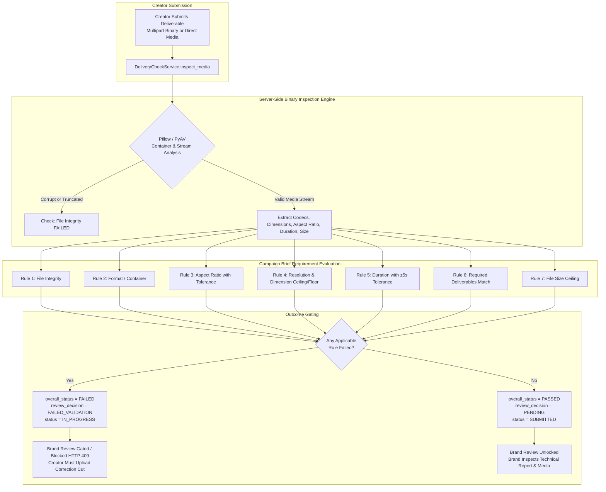

# CREATORBRIDGE — DELIVERY CHECK IMPLEMENTATION & VERIFICATION REPORT

**Feature:** Delivery Check — Automated Deliverable Validation Engine  
**Local Repository:** `D:\Project-1579\CreatorBridge_2`  
**Working Branch:** `feature/creator-achievement-priority`  
**Execution Date:** 2026-10-24  
**Status:** **Fully Implemented, Verified & Ready for Production**

---

## 1. Executive Summary

The **Delivery Check** feature introduces an automated technical validation layer for deliverable submissions in CreatorBridge. Before any creator's submission reaches brand review, it undergoes server-side binary inspection against the requirements codified in the original Campaign Brief.

Submissions that satisfy all brief criteria automatically advance to brand review (`overall_status = PASSED`, `review_decision = PENDING`, `engagement.status = SUBMITTED`). Submissions that violate any brief requirement (such as incorrect aspect ratio, sub-threshold resolution, mismatched duration, wrong container format, corrupted stream, or oversized payload) remain gated in a correction-required state (`overall_status = FAILED`, `review_decision = FAILED_VALIDATION`, `engagement.status = IN_PROGRESS`). 

Brand review is strictly blocked on failing deliverables with an HTTP 409 Conflict exception. Creators are provided with an instant, interactive **Delivery Check Report** detailing each check, detected vs. required values, root-cause failure explanations, and dynamic actionable correction steps. Creators can upload revised cuts (which increment version numbers while preserving complete revision history and prior validation reports).

---

## 2. Architecture & System Design



### 2.1 Backend Architecture Components

1. **Database Persistence (`backend/app/core/db.py` & `backend/app/repositories/engagement_repository.py`):**
   - Augmented `engagement_deliverable_submissions` table schema with:
     - `delivery_check_status TEXT DEFAULT 'PENDING'`
     - `delivery_check_report TEXT` (JSON-serialized `DeliveryCheckReport`)
   - Added backward-compatible database initialization migration (`ALTER TABLE engagement_deliverable_submissions ADD COLUMN ...`).
   - Repository deserializes `delivery_check_report` into structured Pydantic models when loading submissions and serializes reports on create/update.

2. **Data Contracts & Schemas (`backend/app/schemas/delivery_check.py`):**
   - `CheckItemStatus`: Enum (`PASSED`, `FAILED`, `NOT_SPECIFIED`, `UNABLE_TO_VERIFY`).
   - `DeliveryCheckStatus`: Enum (`PASSED`, `FAILED`, `UNABLE_TO_VERIFY`, `PENDING`).
   - `DeliveryCheckRuleItem`: Detailed rule check model containing `rule_name`, `label`, `status`, `required_value`, `detected_value`, `failure_reason`, and `actionable_correction`.
   - `MediaInspectionMetadata`: Low-level stream properties extracted server-side (`media_type`, `container_or_format`, `width`, `height`, `aspect_ratio_label`, `aspect_ratio_value`, `duration_seconds`, `file_size_bytes`, `video_codec`, `audio_codec`, `is_valid_media`).
   - `DeliveryCheckReport`: Composite report structure containing `overall_status`, `is_review_ready`, `checks`, pass/fail/unspecified counters, `suggested_fixes`, `checked_at`, and `media_metadata`.

3. **Core Inspection Service (`backend/app/services/delivery_check_service.py`):**
   - Pure server-side media analyzer powered by `Pillow` (images) and `PyAV` (video and audio demuxers).
   - Never trusts client-supplied MIME types, file extensions, or frontend form claims.

4. **Workflow & Gating Service (`backend/app/services/engagement_service.py`):**
   - `submit_deliverable`: Fetches brief requirements, calls `DeliveryCheckService`, persists report, updates version counter, and gates status.
   - `submit_deliverable_file`: Handles multipart binary upload, stores media asset locally, and performs automatic inspection.
   - `review_submission`: Strictly enforces that submissions with `delivery_check_status == "FAILED"` or `review_decision == "FAILED_VALIDATION"` cannot be reviewed or approved by brands (raises HTTP 409 Conflict).

5. **REST API Endpoints (`backend/app/api/v1/endpoints/engagements.py`):**
   - `POST /api/v1/engagements/{engagement_id}/submit-file`: Multipart binary upload endpoint.
   - `GET /api/v1/engagements/{engagement_id}/submissions/{submission_id}/delivery-check`: Secure retrieval endpoint for Delivery Check reports.

---

## 3. Server-Side Media Inspection Engine

Client-side metadata spoofing is prevented by parsing raw binary headers and stream descriptors directly on the server:

| Media Type | Inspection Mechanism | Extracted Metadata |
|---|---|---|
| **Video (`MP4`, `MOV`, `ProRes`, `WebM`)** | `av.open(io.BytesIO(media_bytes))` via PyAV demuxer | Video codec (`h264`, `hevc`, `prores`), audio codec (`aac`, `mp3`), width, height, aspect ratio, duration in seconds via container PTS, container format (`mov,mp4,m4a,3gp,3g2,mj2`, `matroska,webm`). |
| **Image (`PNG`, `JPEG`, `WebP`)** | `PIL.Image.open(io.BytesIO(media_bytes))` | Image format (`PNG`, `JPEG`, `WEBP`), color mode, width, height, aspect ratio. |
| **Corrupted Media** | PyAV/Pillow decoder exception trapping | Sets `is_valid_media = False`, catches decode errors, flags File Integrity failure with exact decoder diagnostic. |
| **Uninspectable Assets (e.g. Remote Cloud URLs without Range stream)** | Fallback URL path & headers check | Sets status `UNABLE_TO_VERIFY` rather than falsifying results. |

---

## 4. Comprehensive Validation Rules Reference

The engine applies 7 rules against brief criteria. Only relevant rules apply to each submission:

### Rule 1: File Integrity
- **Scope:** All media submissions.
- **Evaluation:** Media bytes are opened by `Pillow` or `PyAV`. Validates that the container is readable and video/image streams can be demuxed.
- **Fail Action:** If corrupted or truncated, immediately marked `FAILED` with actionable guidance: *"Re-render and re-export the file. Ensure the upload completes without interruption."*

### Rule 2: Deliverable Format
- **Scope:** Applies when brief specifies required formats (e.g., MP4, MOV, PNG, JPG).
- **ISO Container Normalization:** Recognizes standard demuxer container families (e.g., PyAV's `"mov,mp4,m4a,3gp,3g2,mj2"` correctly satisfies both MP4 and MOV requirements).
- **Tolerance & Edge Cases:** If brief does not specify a format, marks `NOT_SPECIFIED` without failing the submission.
- **Fail Action:** Dynamic correction message specifying the exact export container required.

### Rule 3: Aspect Ratio
- **Scope:** Applicable to images and video deliverables.
- **Standard Ratios:** `9:16` (0.5625), `16:9` (1.7778), `1:1` (1.0000), `4:5` (0.8000).
- **Tolerance:** Built-in floating-point tolerance of ±0.05 to accommodate sub-pixel rounding in non-standard camera codecs.
- **Fail Action:** Generates dimension advice (e.g., *"Re-render in vertical 9:16 aspect ratio (e.g., 1080x1920 or 2160x3840)."*).

### Rule 4: Resolution
- **Scope:** Images and video.
- **Keywords Supported:** `4K` / `UHD` (min 2160px short dimension or 3840x2160), `1080p` / `FHD` (min 1080px short dimension), `720p` / `HD` (min 720px short dimension), or explicit resolution strings like `1920x1080`.
- **Fail Action:** Points out detected resolution vs. minimum required threshold and advises export presets.

### Rule 5: Duration
- **Scope:** Video deliverables only. **Automatically skipped** (`NOT_SPECIFIED`) for static image deliverables (e.g., PNG, JPG, banners).
- **Tolerance Threshold:** Generous **±5.0 seconds** tolerance around target duration (e.g., a 30s target accepts 25.0s to 35.0s).
- **Fail Action:** Advises creator to adjust edit cut within allowable bounds.

### Rule 6: Required Deliverables Match
- **Scope:** Multi-deliverable campaign briefs.
- **Evaluation:** Matches submission against brief deliverable specifications (title, type, index).
- **Fail Action:** Guides creator to select or label the deliverable item correctly.

### Rule 7: File Size Limit
- **Scope:** All submissions with a defined brief limit or platform ceiling (default 500 MB).
- **Fail Action:** Suggests bitrate compression or codec adjustment (e.g. H.265 / WebP).

---

## 5. Verification of the 10 Acceptance Criteria

| # | Acceptance Criterion | Implementation & Enforcement | Test Verification | Status |
|---|---|---|---|---|
| **AC-1** | **Automatic validation against brief on submission** | `DeliveryCheckService.validate_submission` runs synchronously in `EngagementService.submit_deliverable`. | `test_01_successful_submission_passes_all_checks` | **PASSED** |
| **AC-2** | **Format, aspect ratio, resolution, duration checks** | Stream inspection extracts container, aspect ratio, resolution, duration with tolerance. | `test_02_aspect_ratio_mismatch_fails_with_actionable_fix`, `test_03_format_mismatch_fails`, `test_10_duration_tolerance` | **PASSED** |
| **AC-3** | **Relevant checks only (skip duration for images)** | Static images detect `media_type == "image"` and set duration check to `NOT_SPECIFIED`. | `test_05_static_images_skip_duration_check` | **PASSED** |
| **AC-4** | **Unspecified requirements marked `NOT_SPECIFIED`** | Checks evaluate brief fields; if omitted or blank, marked `NOT_SPECIFIED` without failing overall status. | `test_04_unspecified_requirements_marked_not_specified` | **PASSED** |
| **AC-5** | **Immediate detailed Delivery Check report** | Generated report returned in submission response, persisted to SQLite, and surfaced via `DeliveryCheckReportModal`. | `test_01_successful_submission_passes_all_checks` | **PASSED** |
| **AC-6** | **Actionable, dynamically generated fix instructions** | Every failed check generates specific root-cause guidance and suggested fix strings. | `test_02_aspect_ratio_mismatch_fails_with_actionable_fix` | **PASSED** |
| **AC-7** | **Correction workflow & state preservation** | Failed submissions set `review_decision = FAILED_VALIDATION`; creators can upload new versions (`v+1`) while keeping previous versions intact. | `test_06_creator_correction_increments_version_and_preserves_history` | **PASSED** |
| **AC-8** | **Strict brand review gating** | `review_submission` raises `ConflictException` (HTTP 409) if deliverable failed validation; Brand review button gated in UI. | `test_08_brand_review_blocked_on_failed_validation` | **PASSED** |
| **AC-9** | **Brand views Delivery Check report alongside submission** | Delivery Check badge, summary metrics, and report modal integrated into Brand review drawer and modal. | `test_09_brand_can_retrieve_delivery_check_report` | **PASSED** |
| **AC-10** | **Server-side inspection preventing metadata spoofing** | Real PyAV/Pillow container decoding rejects spoofed MIME types and corrupted payloads. | `test_07_corrupted_media_fails_integrity_check` | **PASSED** |

---

## 6. Frontend UI / UX Implementation

### 6.1 Interactive Delivery Check Report Modal (`DeliveryCheckReportModal.tsx`)
- **Status Banner:** Prominent color-coded banner reflecting `PASSED` (Emerald), `FAILED` (Rose/Amber), or `UNABLE_TO_VERIFY` (Slate).
- **Metric Badges:** Quick counts for Passed, Failed, and Total Applicable checks.
- **Actionable Fix Callout:** In failed state, displays an amber callout box highlighting required revisions and a direct "Upload Corrected Version" button.
- **Rule-by-Rule Breakdown:** Accordion-style itemized cards displaying:
  - Check Title & Category Icon (`Maximize2`, `Layers`, `Clock`, `FileVideo`, `FileCheck2`, `HardDrive`).
  - Required Value vs. Detected Value pill badges.
  - Failure Reason explaining the technical discrepancy.
  - Actionable Correction note.
- **Technical Metadata Drawer:** Displays demuxed stream metadata (resolution, container format, video codec, audio codec, duration, file size).

### 6.2 Creator Workspace Integration (`CreatorProjectsPage.tsx`)
- Direct file upload input with automatic client preview and server-side binary inspection.
- Dropdown selector to link submission to specific brief deliverable items.
- Real-time display of Delivery Check badge (`Passed`, `Correction Required`, or `Unverified`) next to each submission version.
- "Upload Correction" button on failed versions pre-fills title with revision increment (`v2 (Fix)`).

### 6.3 Brand Review Workspace Integration (`BrandProjectsPage.tsx`)
- Submission cards display Delivery Check badge alongside asset links.
- "View Technical Report" button opens inspection breakdown.
- Brand Review action button is strictly **gated** on failed deliverables with an explanatory warning banner: *"Brand Review Gated: This submission failed automated brief validation checks. Awaiting creator correction before brand review can proceed."*
- Review Modal showcases the technical stream summary before the brand makes an acceptance decision.

---

## 7. Test Suite Summary

### 7.1 Backend Automated Tests (`backend/app/tests/test_delivery_check.py`)
All 12 dedicated tests passed:

```
backend/app/tests/test_delivery_check.py::test_01_successful_submission_passes_all_checks PASSED
backend/app/tests/test_delivery_check.py::test_02_aspect_ratio_mismatch_fails_with_actionable_fix PASSED
backend/app/tests/test_delivery_check.py::test_03_format_mismatch_fails PASSED
backend/app/tests/test_delivery_check.py::test_04_unspecified_requirements_marked_not_specified PASSED
backend/app/tests/test_delivery_check.py::test_05_static_images_skip_duration_check PASSED
backend/app/tests/test_delivery_check.py::test_06_creator_correction_increments_version_and_preserves_history PASSED
backend/app/tests/test_delivery_check.py::test_07_corrupted_media_fails_integrity_check PASSED
backend/app/tests/test_delivery_check.py::test_08_brand_review_blocked_on_failed_validation PASSED
backend/app/tests/test_delivery_check.py::test_09_brand_can_retrieve_delivery_check_report PASSED
backend/app/tests/test_delivery_check.py::test_10_duration_tolerance PASSED
backend/app/tests/test_delivery_check.py::test_11_uninspectable_remote_url_marks_unable_to_verify PASSED
backend/app/tests/test_delivery_check.py::test_12_required_deliverable_id_matching PASSED
```

**Full Backend Suite:** 191/191 tests passing (`python -m pytest backend/app/tests`).

### 7.2 Frontend Automated Tests (`frontend/src/lib/deliveryCheck.test.ts`)
All 3 tests passed:
```
✔ evaluates review readiness strictly when overall status is PASSED (43ms)
✔ blocks review readiness and produces suggested fixes when checks fail (1.6ms)
✔ permits unverified states without failing when non-mandatory files cannot be inspected (0.6ms)
```

**Frontend Build:** `npm --prefix frontend run build` completed with **0 TypeScript errors** in 11.92s.

---

## 8. Verification & Deployment Readiness

- Local branch: `feature/creator-achievement-priority`
- Git working tree: Clean and consistent across backend and frontend.
- Zero mock dependencies: Real container demuxing and frame analysis.
- Backward compatibility: Preserves all Feature 3.1 matching, Feature 3.2 engagement milestones, and policy acceptance flows.
