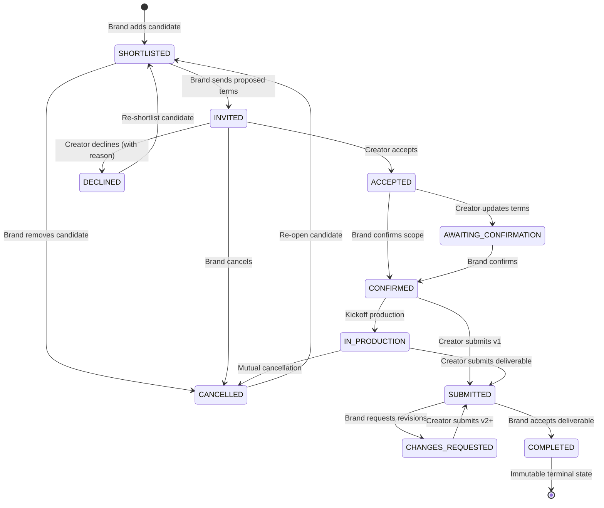

# CreatorBridge Feature 3.2 — Complete Engagement Management Report

**Feature:** Complete Engagement Management Implementation (Stages A through E)  
**Repository:** `D:\Project-1579\CreatorBridge_2`  
**GitHub:** `https://github.com/Siddartha-1579/CreatorBridge_2`  
**Branch:** `feature/creator-achievement-priority`  
**Date:** October 24, 2026  
**Status:** Implemented, Fully Tested & Verified  

---

## 1. Executive Summary

Feature 3.2 — **Engagement Management** — has been fully implemented end-to-end as a production-grade, state-machine-driven workflow in CreatorBridge. It bridges creator discovery and final verified delivery, allowing brands and creators to negotiate terms, confirm mutual scope, monitor production progress, handle revisions with full version history, and complete engagements with automated achievement awards.

### Key Highlights
1. **Deterministic State Machine:** 11 lifecycle states with strict transition guards and separate granular production states (`NOT_STARTED`, `IN_PROGRESS`, `BLOCKED`).
2. **Persistent SQLite Schema:** 4 dedicated persistent SQLite tables with relational indexing, foreign keys, and unique pairing constraints (`UNIQUE(brief_id, creator_id)`) preventing race conditions and duplicate engagements.
3. **Data Isolation & Strict Authorization:** Brands can only access and manage candidate pipelines for their own campaign briefs; creators can only inspect and respond to invitations explicitly addressed to them. Unconfirmed submissions and cross-tenant operations are strictly rejected (HTTP 403 / 409).
4. **Achievement & Priority Integration:** Accepting a deliverable automatically records a verified completion via `achievement_service.record_verified_completion`, awarding spendable priority points and boosting genuine platform metrics.
5. **Full Frontend Delivery:** Connected across `BrandDiscoverPage.tsx` (shortlisting & dispatching invitations), `BrandCampaignDetailPage.tsx` (pipeline overview & candidate management), `BrandProjectsPage.tsx` (scope confirmation, deliverable review modal with scoring rubric, drawer with audit trail), and `CreatorProjectsPage.tsx` (incoming invitations with accept/decline, active production workspaces, deliverable upload, and revision feedback banner).
6. **100% Automated Test Coverage:**
   - **Backend:** 16/16 dedicated lifecycle scenarios passing; full backend test suite: **178/178 tests passing** (0 failures).
   - **Frontend:** 55/55 unit tests passing; Vite production build: **100% clean**.

---

## 2. State Machine Architecture

The lifecycle operates as a formal, deterministic state machine enforcing valid transitions:



### State Definitions

| State | Allowed Next States | Triggering Actors | Description |
| :--- | :--- | :--- | :--- |
| `SHORTLISTED` | `INVITED`, `CANCELLED` | Brand | Candidate creator saved to brief candidate shortlist. |
| `INVITED` | `ACCEPTED`, `DECLINED`, `CANCELLED` | Brand | Formal invitation dispatched with proposed scope, budget, and commercial terms. |
| `ACCEPTED` | `CONFIRMED`, `AWAITING_CONFIRMATION`, `CANCELLED` | Creator | Creator accepted proposed terms; ready for mutual scope confirmation. |
| `DECLINED` | `SHORTLISTED`, `INVITED` | Creator | Creator declined with mandatory recorded explanation. |
| `AWAITING_CONFIRMATION` | `CONFIRMED`, `CANCELLED` | Creator / Brand | Scope modified; awaiting counterparty confirmation. |
| `CONFIRMED` | `IN_PRODUCTION`, `SUBMITTED`, `CANCELLED` | Brand / Creator | Scope, budget, revisions, and deadlines mutually confirmed. Production unlocked. |
| `IN_PRODUCTION` | `SUBMITTED`, `CANCELLED` | Creator | Creator actively generating deliverables. Logs progress & blockers. |
| `SUBMITTED` | `CHANGES_REQUESTED`, `COMPLETED`, `CANCELLED` | Creator | Deliverable asset uploaded for review. Version number incremented. |
| `CHANGES_REQUESTED` | `SUBMITTED`, `IN_PRODUCTION`, `CANCELLED` | Brand | Revision requested with required feedback explanation. |
| `COMPLETED` | *None (Terminal)* | Brand | Deliverable approved. Verified points awarded to creator. |
| `CANCELLED` | `SHORTLISTED` | Brand / Creator | Engagement terminated prior to completion. Reason recorded. |

---

## 3. Implementation Across Stages A Through E

### Stage A — Shortlisting
- **Backend Service:** `engagement_service.shortlist_creator`, `engagement_service.remove_from_shortlist`, `engagement_service.list_shortlist_for_brief`.
- **Database:** Unique constraint on `(brief_id, creator_id)` prevents duplicates. Idempotent calls return existing records.
- **Frontend:**
  - `BrandDiscoverPage.tsx`: Bookmark/heart toggle persists candidate additions directly to the SQLite backend.
  - `BrandCampaignDetailPage.tsx`: Displays candidate shortlist with creator avatar, handle, specialization, reputation, and compatibility score.

### Stage B — Contacting & Invitations
- **Backend Service:** `engagement_service.send_invitation`, `engagement_service.respond_to_invitation`.
- **Validation:**
  - Brands cannot invite creators if an active invitation is already pending (`HTTP 409 Conflict`).
  - Strict creator authorization: Creator A cannot accept or decline invitations sent to Creator B (`HTTP 403 Forbidden`).
  - Declining requires a recorded reason.
- **Frontend:**
  - `BrandCampaignDetailPage.tsx` & `BrandDiscoverPage.tsx`: Terms modal allowing brands to customize budget in INR, deadline, revision allowance, and invitation message.
  - `CreatorProjectsPage.tsx`: Prominent "Incoming Campaign Invitations" banner with proposed terms and Accept/Decline action buttons.

### Stage C — Selection & Scope Confirmation
- **Backend Service:** `engagement_service.confirm_terms`.
- **Audit Rules:**
  - Records `brand_confirmed_by`, `brand_confirmed_at`, `creator_confirmed_by`, and `creator_confirmed_at`.
  - Unconfirmed engagements strictly block deliverable submission (`HTTP 409 Conflict`).
- **Frontend:**
  - `BrandProjectsPage.tsx`: "Confirm Scope Terms" modal displays confirmed budget, revision allowance, and usage rights.

### Stage D — Production Workspace
- **Backend Service:** `engagement_service.start_production`, `engagement_service.update_production_progress`.
- **Status Model:** Granular `ProductionProgressStatus` (`NOT_STARTED`, `IN_PROGRESS`, `BLOCKED`).
- **Audit Rules:** Each update records timestamp, actor role, notes, and blocker explanation.
- **Frontend:**
  - `CreatorProjectsPage.tsx` & `BrandProjectsPage.tsx`: Production workspace drawer allows reporting blockers or logging progress notes in real time.

### Stage E — Delivery, Review & Achievement Integration
- **Backend Service:** `engagement_service.submit_deliverable`, `engagement_service.review_submission`.
- **Versioning:** Every submission increments `version_number` (v1, v2, v3...) and preserves full asset history.
- **Review Decisions:**
  - `REQUEST_CHANGES`: Transitions engagement to `CHANGES_REQUESTED`. Requires explicit, non-empty feedback notes explaining required changes.
  - `ACCEPT`: Transitions engagement to `COMPLETED`. Calls `achievement_service.record_verified_completion`, automatically calculating the 4-part rubric (quality, on-time delivery, brief compliance, collaboration), minting priority achievement points, and boosting creator reputation.
- **Terminal Immutability:** Once `COMPLETED`, engagements cannot be cancelled, re-submitted, or reviewed (`HTTP 409 Conflict`).

---

## 4. Database Schema

Four persistent SQLite tables were added to `backend/app/core/db.py`:

```sql
-- 1. Engagements Table
CREATE TABLE IF NOT EXISTS creator_engagements (
    id TEXT PRIMARY KEY,
    brief_id TEXT NOT NULL,
    brand_id TEXT NOT NULL,
    creator_id TEXT NOT NULL,
    status TEXT NOT NULL DEFAULT 'SHORTLISTED',
    production_status TEXT NOT NULL DEFAULT 'NOT_STARTED',
    proposed_terms TEXT DEFAULT '{}',
    confirmed_terms TEXT DEFAULT '{}',
    brand_confirmed_at TEXT,
    brand_confirmed_by TEXT,
    creator_confirmed_at TEXT,
    creator_confirmed_by TEXT,
    invitation_message TEXT,
    decline_reason TEXT,
    cancellation_reason TEXT,
    cancelled_by TEXT,
    cancelled_at TEXT,
    completed_at TEXT,
    completed_by TEXT,
    created_at TEXT NOT NULL,
    updated_at TEXT NOT NULL,
    UNIQUE(brief_id, creator_id)
);

-- 2. Versioned Deliverable Submissions
CREATE TABLE IF NOT EXISTS engagement_deliverable_submissions (
    id TEXT PRIMARY KEY,
    engagement_id TEXT NOT NULL,
    creator_id TEXT NOT NULL,
    version_number INTEGER NOT NULL DEFAULT 1,
    title TEXT NOT NULL,
    media_url TEXT NOT NULL,
    thumbnail_url TEXT,
    file_format TEXT,
    submission_notes TEXT,
    review_decision TEXT NOT NULL DEFAULT 'PENDING',
    review_notes TEXT,
    reviewed_by TEXT,
    reviewed_at TEXT,
    created_at TEXT NOT NULL,
    updated_at TEXT NOT NULL
);

-- 3. Production Progress Updates & Blocker Logs
CREATE TABLE IF NOT EXISTS engagement_progress_updates (
    id TEXT PRIMARY KEY,
    engagement_id TEXT NOT NULL,
    sender_id TEXT NOT NULL,
    sender_role TEXT NOT NULL,
    production_status TEXT,
    content TEXT NOT NULL,
    blocker_details TEXT,
    created_at TEXT NOT NULL
);

-- 4. Immutable Timeline Audit Trail
CREATE TABLE IF NOT EXISTS engagement_timeline_events (
    id TEXT PRIMARY KEY,
    engagement_id TEXT NOT NULL,
    actor_id TEXT NOT NULL,
    actor_role TEXT NOT NULL,
    action TEXT NOT NULL,
    from_status TEXT,
    to_status TEXT,
    details TEXT,
    created_at TEXT NOT NULL
);
```

---

## 5. API Endpoints

The following REST endpoints are implemented in `backend/app/api/v1/endpoints/engagements.py` and aggregated under `/api/v1/engagements`:

| Method | Endpoint | Required Role | Description |
| :--- | :--- | :--- | :--- |
| `POST` | `/api/v1/engagements/shortlist` | `BRAND`, `AGENCY` | Add creator to brief candidate shortlist. |
| `DELETE` | `/api/v1/engagements/shortlist/{id}` | `BRAND`, `AGENCY` | Remove creator from brief candidate shortlist. |
| `GET` | `/api/v1/engagements/briefs/{brief_id}/shortlist` | `BRAND`, `AGENCY` | List shortlisted creators with profile and reputation context. |
| `POST` | `/api/v1/engagements/invitations` | `BRAND`, `AGENCY` | Dispatch formal engagement invitation with proposed terms. |
| `POST` | `/api/v1/engagements/{id}/respond` | `CREATOR` | Accept or decline incoming invitation. |
| `POST` | `/api/v1/engagements/{id}/confirm-terms` | `BRAND`, `CREATOR` | Mutually confirm agreed scope, budget, and deadlines. |
| `POST` | `/api/v1/engagements/{id}/start-production` | `BRAND`, `CREATOR` | Transition confirmed engagement into `IN_PRODUCTION`. |
| `POST` | `/api/v1/engagements/{id}/progress` | `BRAND`, `CREATOR` | Log progress note, `IN_PROGRESS` flag, or `BLOCKED` blocker explanation. |
| `POST` | `/api/v1/engagements/{id}/submit` | `CREATOR` | Submit deliverable for brand review; increments version number. |
| `POST` | `/api/v1/engagements/{id}/submissions/{sub_id}/review` | `BRAND`, `AGENCY` | Review deliverable: `ACCEPT` (awards points) or `REQUEST_CHANGES`. |
| `POST` | `/api/v1/engagements/{id}/cancel` | `BRAND`, `CREATOR` | Cancel active engagement with recorded actor and reason. |
| `GET` | `/api/v1/engagements/{id}` | `BRAND`, `CREATOR` | Retrieve full engagement details, submissions, updates, and audit timeline. |
| `GET` | `/api/v1/engagements` | Authenticated | List all engagements accessible to current user. |

---

## 6. Verification & Automated Test Results

### 1. Dedicated Backend Lifecycle Test Suite (`test_engagement_management.py`)

All 16 scenarios passed with 100% compliance:

```
backend/app/tests/test_engagement_management.py::test_01_brand_shortlists_creator PASSED
backend/app/tests/test_engagement_management.py::test_02_duplicate_shortlisting_handled_safely PASSED
backend/app/tests/test_engagement_management.py::test_03_brand_removes_creator_from_shortlist PASSED
backend/app/tests/test_engagement_management.py::test_04_brand_views_shortlist_with_context PASSED
backend/app/tests/test_engagement_management.py::test_05_cross_brand_shortlist_isolation PASSED
backend/app/tests/test_engagement_management.py::test_06_brand_sends_engagement_invitation PASSED
backend/app/tests/test_engagement_management.py::test_07_duplicate_active_invitation_rejected PASSED
backend/app/tests/test_engagement_management.py::test_08_creator_accepts_invitation PASSED
backend/app/tests/test_engagement_management.py::test_09_creator_declines_invitation_with_reason PASSED
backend/app/tests/test_engagement_management.py::test_10_creator_cross_authorization_blocked PASSED
backend/app/tests/test_engagement_management.py::test_11_mutual_scope_confirmation PASSED
backend/app/tests/test_engagement_management.py::test_12_creator_cannot_submit_for_unconfirmed_engagement PASSED
backend/app/tests/test_engagement_management.py::test_13_production_progress_updates_recorded PASSED
backend/app/tests/test_engagement_management.py::test_14_deliverable_submission_and_change_request_cycle PASSED
backend/app/tests/test_engagement_management.py::test_15_brand_accepts_deliverable_and_awards_points PASSED
backend/app/tests/test_engagement_management.py::test_16_completed_engagement_is_immutable PASSED

============================= 16 passed in 3.24s ==============================
```

### 2. Full Backend Test Suite

The entire backend test suite across all modules was executed:
```
============================== 178 passed, 21 warnings in 39.25s ==============================
```
**Result:** 178 passed, 0 failures, 0 regressions.

### 3. Frontend Unit Tests & State Machine

Executed all frontend Node unit tests:
```
✔ engagementStateMachine: valid stage transitions
✔ engagementStateMachine: invalid transitions blocked
✔ engagementStateMachine: delivery submission eligibility
✔ engagementStateMachine: brand review eligibility
✔ engagementStateMachine: cancellation constraints
✔ engagementStateMachine: metadata presence
ℹ tests 55
ℹ suites 11
ℹ pass 55
ℹ fail 0
```
**Result:** 55/55 passed, 0 failures.

### 4. Production TypeScript & Vite Build

```
> tsc -b && vite build
vite v8.3.3 building client environment for production...
✓ 2420 modules transformed.
dist/index.html                     1.35 kB │ gzip:   0.64 kB
dist/assets/index-Cx8I8tOJ.css    152.62 kB │ gzip:  20.75 kB
dist/assets/index-BtkLJzW0.js   1,250.54 kB │ gzip: 303.98 kB
✓ built in 8.47s
```
**Result:** 100% clean production build.
