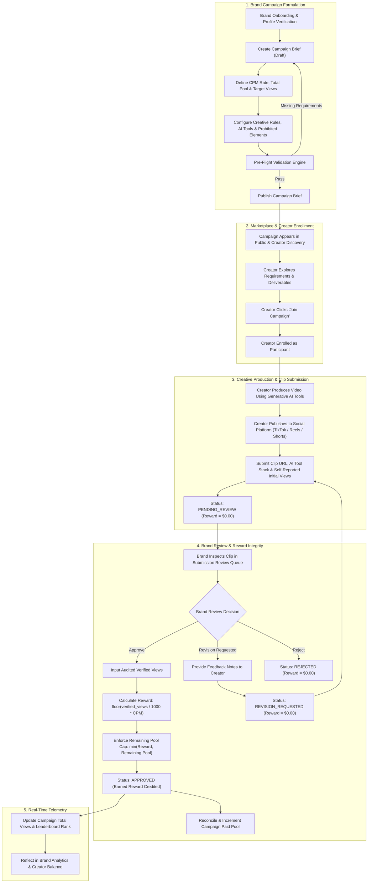
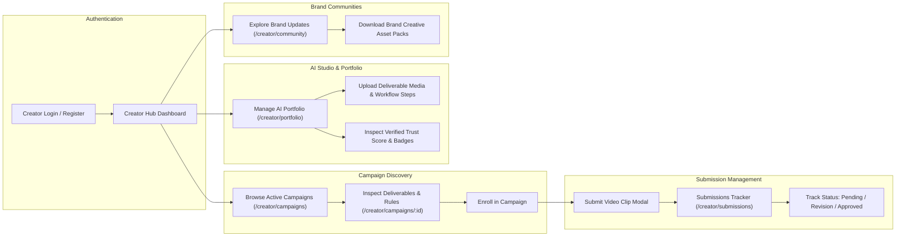
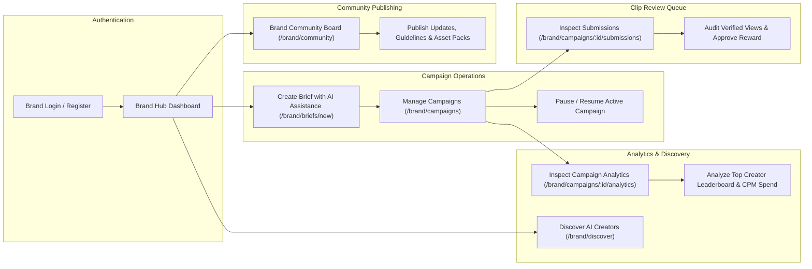
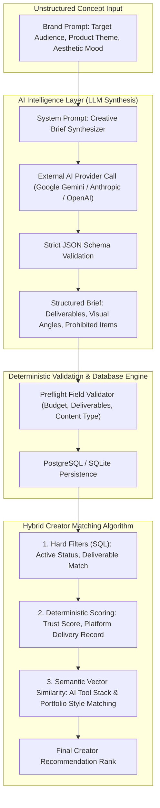
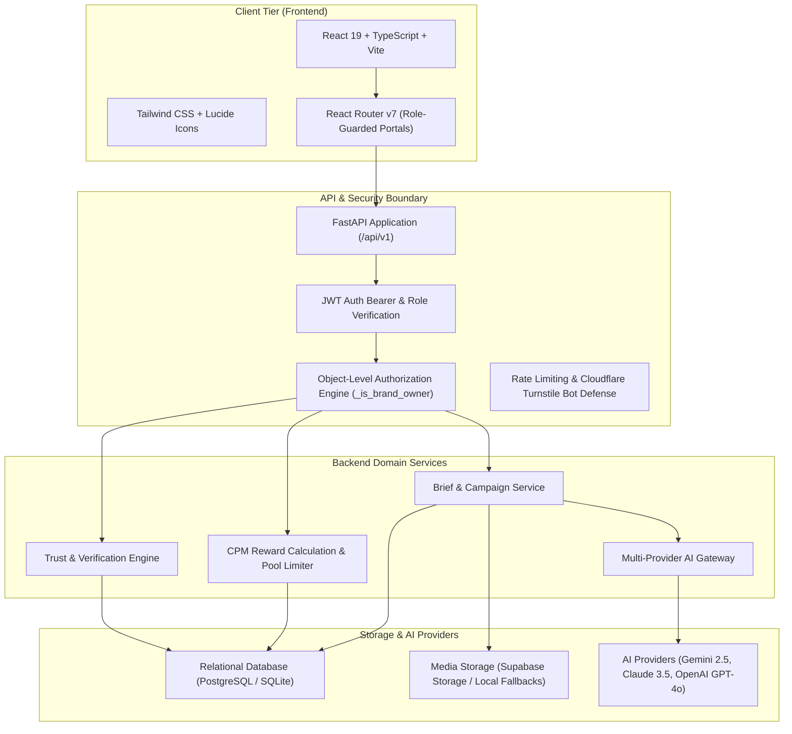

# CreatorBridge — System Workflows & Architecture Diagrams

This document illustrates the end-to-end workflows, role-separated interactions, AI processing layers, and infrastructure architecture powering CreatorBridge.

---

## 1. Complete Campaign Lifecycle

The following sequence details how a brand launches a reward-backed campaign, creators enroll and submit content, and submissions undergo verification and reward credit.

---

## 2. Independent Creator Hub Workflow

Creators operate in a dedicated, isolated hub tailored for discovery, production management, and portfolio verification.

---

## 3. Independent Brand Hub Workflow

Brands and agencies have dedicated workflows for campaign formulation, creator discovery, submission moderation, and campaign ROI tracking.

---

## 4. AI-Assisted Matching & Generation Pipeline

CreatorBridge combines multi-provider generative AI with deterministic filtering to prevent hallucinated scores and guarantee rule integrity.

---

## 5. End-to-End System Architecture

